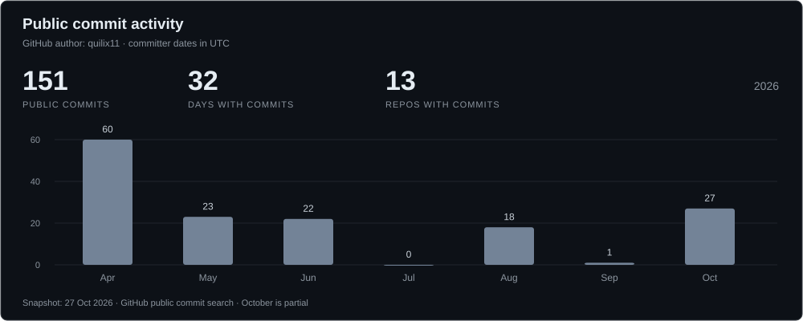

<h1>quilix11</h1>

<strong>Python · Backend · Infrastructure</strong>

  
  
  

I write Python APIs, command-line tools and Telegram bots. My projects cover Git hooks, webhook debugging, parsing, monitoring and configuration backups.

I'm currently learning **Kubernetes**, alongside **Terraform and AWS**: workloads, services, networking, databases and storage.

### Selected repositories

| Project | What it does |
| :--- | :--- |
| [**AWS**](https://github.com/quilix11/AWS) Terraform · HCL · AWS | Infrastructure definitions for VPCs, subnets, EC2, ALB, RDS PostgreSQL, S3 and IAM. |
| [**webhook-replay**](https://github.com/quilix11/webhook-replay) FastAPI · async SQLAlchemy · httpx | Receives and stores webhook headers and payloads, then lets you inspect and resend them. Includes migrations and API tests. |
| [**git-reviewer**](https://github.com/quilix11/git-reviewer) Python · Git hooks · Gemini | Reviews the staged diff before a commit and prints the result in the terminal. A critical result blocks the commit. |
| [**wiki-quizlet**](https://github.com/quilix11/wiki-quizlet) Python · Telegram · SQLite | Ukrainian Wikipedia quizzes with article reading, AI and rule-based question generation, scores and rankings. |
| [**uptime-service**](https://github.com/quilix11/uptime-service) FastAPI · Taskiq · Redis | Scheduled HTTP checks with background jobs and Redis-backed results. Paused prototype. |
| [**stratum**](https://github.com/quilix11/stratum) Python · SQLAlchemy · parser plugins | Early workspace/content models and an extensible parser for Markdown and text files. |
| [**ast-graph**](https://github.com/quilix11/ast-graph) Python AST · Gemini · Mermaid | Reads Python imports, functions and classes, then generates a Mermaid diagram. Experimental, with known errors. |
| [**k8s**](https://github.com/quilix11/k8s) Kubernetes · YAML | Deployment, Service and ConfigMap manifests: replicas, application/database workloads and CPU/memory requests and limits. |

### Stack

  
  
  
  
  
  

Also in my projects: SQLAlchemy, Pydantic, Alembic, SQLite, Taskiq, asyncio, httpx, Typer, Rich and GitHub Actions.

  
  
  

### Activity

Chart: public commits attributed to this GitHub account, snapshot dated 27 Oct 2026. The counters above update separately.

<strong>Other repos</strong>

- [-FAE](https://github.com/quilix11/-FAE) — equipment tracking, capacity rules, operator roles, movement history and live dashboards; CQRS and Unit of Work.
- [state-vault](https://github.com/quilix11/state-vault) — a CLI/API prototype for configuration backups.
- [hf-space-waker](https://github.com/quilix11/hf-space-waker) — a GitHub Actions schedule that sends a request to a Hugging Face Space.

