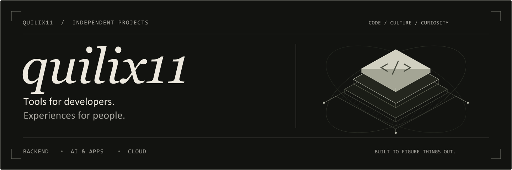
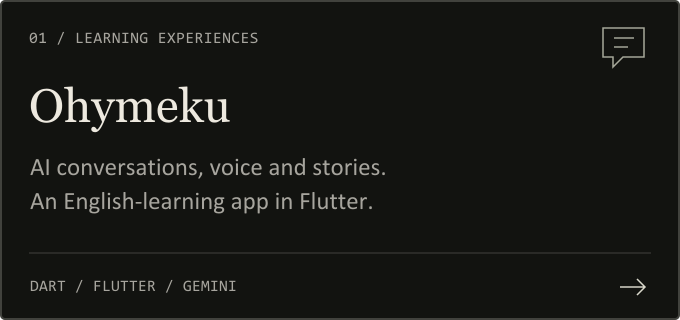
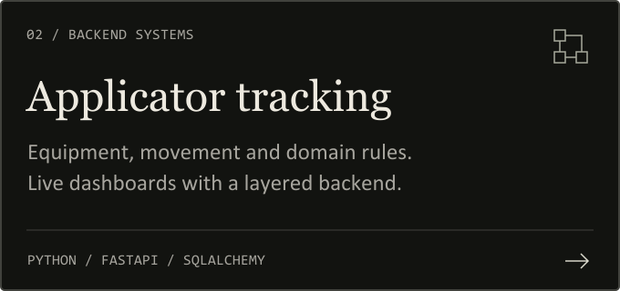
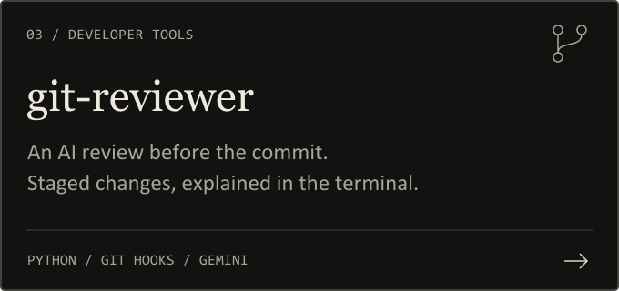
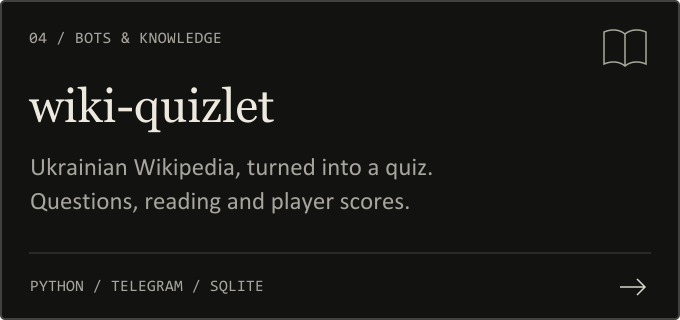

  

## About

I'm **quilix11**. I build software around things I want to understand or make easier: reviewing a commit, tracing equipment, practicing a language, replaying a webhook, or getting an application running in the cloud.

My work spans **backend services, developer tools, AI integrations, Flutter apps, Telegram bots, web interfaces and infrastructure experiments**. Python is a recurring tool; Dart, JavaScript, SQL and Terraform are part of the picture too.

<table>
  <tr>
    <td>
      <strong>What draws me in</strong>  
      <strong>Useful automation.</strong> Git hooks, command-line workflows, scheduled jobs and tools that remove repetitive steps.  
      <strong>Interactive learning.</strong> Conversations, voice, quizzes, characters and progress systems that turn practice into an experience.  
      <strong>How systems fit together.</strong> Domain rules, APIs, persistence, background workers, containers and the infrastructure underneath them.
    </td>
  </tr>
</table>

I explore ideas by building them. This profile brings together larger application projects and smaller prototypes, including work in progress. My recent infrastructure work focuses on **Kubernetes**, alongside earlier **AWS and Terraform** experiments.

## Selected projects

<table>
  <tr>
    <td width="50%"></td>
    <td width="50%"></td>
  </tr>
  <tr>
    <td width="50%"></td>
    <td width="50%"></td>
  </tr>
</table>

More about these four projects

- **[Ohymeku](https://github.com/quilix11/ohymeku)** combines AI role-play, spoken conversations, vocabulary review, grammar exercises, story choices and locally saved progress.
- **[Applicator tracking](https://github.com/quilix11/-FAE)** models machines, zones, capacity rules, movement history and operator roles. Its backend explores CQRS, Unit of Work, dependency injection and WebSocket updates.
- **[git-reviewer](https://github.com/quilix11/git-reviewer)** reads the staged diff, formats a Gemini review with Rich and blocks commits when the model reports critical issues.
- **[wiki-quizlet](https://github.com/quilix11/wiki-quizlet)** turns Ukrainian Wikipedia articles into Telegram quiz rounds, with player scores and a rule-based generation fallback.

## Toolbox

| Area | Tools and approaches in my repositories |
| :--- | :--- |
| Languages | Python · Dart · JavaScript · SQL · HCL · HTML/CSS |
| Backend & data | FastAPI · Pydantic · SQLAlchemy · PostgreSQL · SQLite · Alembic · Redis |
| Architecture | Layered domain models · CQRS · Unit of Work · dependency injection · async I/O |
| AI & interaction | Gemini API · structured model responses · Telegram bots · speech recognition · text-to-speech |
| Apps & interfaces | Flutter · local persistence · responsive web layouts · Bootstrap |
| Automation & delivery | Git hooks · Typer · Rich · Taskiq · Docker / Compose · GitHub Actions · GitHub Pages |
| Infrastructure practice | Terraform · AWS VPC / EC2 / ALB / RDS / S3 / IAM · Kubernetes Deployments / Services / ConfigMaps |

## The rest of the workbench

<strong>Developer tools & backend experiments</strong>

| Project | What I am exploring |
| :--- | :--- |
| [webhook-replay](https://github.com/quilix11/webhook-replay) | Receiving, storing, inspecting and replaying webhook payloads through an async API, with migrations and API tests. |
| [state-vault](https://github.com/quilix11/state-vault) | A CLI and API prototype for finding, backing up and restoring application configuration files. |
| [ast-graph](https://github.com/quilix11/ast-graph) | An experimental path from Python AST analysis to Gemini-generated Mermaid diagrams. |
| [stratum](https://github.com/quilix11/stratum) | Early workspace/content models and a plugin-based parser for Markdown and text files. |
| [uptime-service](https://github.com/quilix11/uptime-service) | A paused monitoring prototype combining HTTP checks, scheduled Taskiq jobs and Redis-backed results. |

<strong>Cloud, delivery & web</strong>

| Project | What I am exploring |
| :--- | :--- |
| [AWS](https://github.com/quilix11/AWS) | Terraform definitions connecting networking, compute, load balancing, PostgreSQL, object storage and IAM. |
| [k8s](https://github.com/quilix11/k8s) | Kubernetes practice with application/database workloads, services, configuration and resource requests/limits. |
| [hf-space-waker](https://github.com/quilix11/hf-space-waker) | A scheduled GitHub Actions workflow that sends a request to a Hugging Face Space. |
| [quilix11.github.io](https://github.com/quilix11/quilix11.github.io) | A responsive Ukrainian café website with a custom interface and GitHub Pages deployment. |

---

  Built around practical problems, curiosity and the next thing to figure out.

